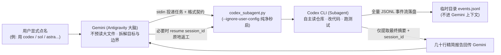

# Antigravity Codex Subagent Skill

让 **Google Antigravity (Gemini)** 在你需要时直接把本地 **OpenAI Codex CLI (`codex exec`)** 当作无头 Subagent 调用——**Gemini 只当“大脑”负责拆解与决策，Codex 当“执行手”负责读大文件、写代码、改 Bug、跑测试，并只向 Gemini 回传精简结构化摘要**，大幅节省 Gemini 上下文窗口与额度，同时免去每次现场搜索 CLI 用法的时间损耗。

---

## 核心设计理念

如果直接让主 Agent 在命令行裸跑另一个 Agent，通常会踩两个大坑：
1. **双倍烧额度**：主 Agent 先把几千行源码读进上下文，再把子 Agent 刷屏的终端工具日志和全量 Diff 原样塞回上下文，反而更费 Token。
2. **过度绑定或乱触发**：写死全局规则会导致不该调的时候乱调，或者桌面端重型插件拖慢启动。

本 Skill 采用 **按需渐进式披露（Progressive Disclosure）+ 日志落盘摘要回传** 架构：



### 六大特性

- **严格按需显式触发，平时零打扰**：仅当你在对话中提到 `codex` 或具体模型名/简称（如 `sol`、`astra`、`gpt-6.2-sol` 等）时才激活；未提及时 Gemini 完全按原生方式工作，绝不擅自调用或追问。
- **真正省 Gemini 额度**：派单前 Gemini 不预读大文件；执行中全量 JSONL 轨迹落盘至系统临时目录；成功时仅回传几十行结构化结果（`STATUS / SUMMARY / CHANGED_FILES / VERIFICATION / RISKS`），Gemini 仅做轻量 `git status/diff --stat` 校验，异常时才按需深查日志。
- **桌面端重型插件隔离秒启动**：默认附带 `--ignore-user-config`（保留 `~/.codex/auth.json` 登录态，但跳过 ChatGPT 桌面端配置的 `computer-use`、`browser`、`node_repl` MCP 与弹窗通知钩子）。
- **智能会话留痕与多轮续聊**：
  - **写代码 / 重构（`--mode write`）**：自动保留 `session_id`，后续可直接 `resume <session_id>` 在原上下文内追问返工，无需重读整个仓库。
  - **纯分析 / 看代码（`--mode read`）**：默认启用 `--ephemeral` 无痕运行，不污染桌面端历史列表。
- **中英文口语简称自动映射**：支持 `sol` / `astra` / `terra` / `reserve` 及 `低` / `中` / `高` / `超高` / `拉满` 等自然口令，未指定思考档位时按任务复杂度在 `medium` / `high` / `xhigh` 间智能配档。
- **分级沙箱 + 并行派单 + 专项 Review**：内置 `read-only` -> `workspace-write` -> `danger-full-access` 分级授权，支持多实例并行分析、`--worktree` 隔离改码及 `codex exec review` 审查。

---

## 前置条件

1. **Google Antigravity**（支持全局 `~/.gemini/config/` 或项目 `.agents/` Skills 发现机制）。
2. **Python 3.9+**（仅使用标准库，零第三方依赖）。
3. **OpenAI Codex CLI**（满足以下任意一种即可，脚本会自动寻路）：
   - macOS 已安装 **ChatGPT Desktop 客户端**（自动识别内置 `/Applications/ChatGPT.app/Contents/Resources/codex-cli/bin/codex`）；
   - 或通过 npm / Homebrew 等独立安装了 `codex`（在 `$PATH` 中，或通过 `$CODEX_BIN` 指定路径）；
   - 且已完成登录（存在 `~/.codex/auth.json` 或配置了 `OPENAI_API_KEY`）。

---

## 快速安装

克隆仓库后执行一键全局安装脚本（会将本仓库 `skills/` 注册到 `~/.gemini/config/skills.json` 并建立软链接，后续拉取更新或本地修改即时全局生效）：

```bash
git clone https://github.com/renat3u/antigravity-codex-subagent-skill.git
cd antigravity-codex-subagent-skill
./install.sh
```

安装脚本会自动运行环境自检（`doctor`）：

```text
=== CODEX SUBAGENT DOCTOR ===
python_version: 3.9.6
codex_home: /Users/<you>/.codex (exists=True)
codex_bin: /Applications/ChatGPT.app/Contents/Resources/codex-cli/bin/codex
codex_version: codex-cli 0.169.0
auth_configured: True
resolved_default_model: gpt-6.2-sol
status: READY
```

### 卸载全局挂载

```bash
./install.sh --uninstall
```

### 仅在单个项目内启用（不装全局）

在目标项目的 `.agents/skills.json` 中指向本仓库的 `skills` 目录，或直接将 `skills/codex-subagent` 复制到目标项目的 `.agents/skills/codex-subagent`。

---

## 在 Antigravity 中的日常口令示例

安装后，在任意工作区直接用自然语言指挥 Gemini 即可：

| 场景 | 对 Gemini 说的话示例 | 实际触发行为 |
| :--- | :--- | :--- |
| **日常写代码（默认模型）** | `用 codex 给 src/api 加上游标分页并跑通单测` | 调用 `gpt-6.2-sol` + `high` + `workspace-write`，保留 `session_id` |
| **指定旗舰模型攻关** | `让 astra 超高思考排查一下这里的死锁原因并修复` | 调用 `gpt-6.2-astra` + `xhigh` + `workspace-write` |
| **极限推理深度** | `用 sol 拉满重构这个编译器前端模块` | 调用 `gpt-6.2-sol` + `ultra` + `workspace-write` |
| **原地返工续聊** | `让刚才那个 codex 把空数组边界条件也处理一下` | 调用 `codex exec resume <session_id>`，复用原会话上下文 |
| **无痕只读分析** | `让 codex 快速看下 packages/core 的依赖关系` | 调用 `gpt-6.2-sol` + `medium` + `read-only` + `--ephemeral` |
| **未提交代码审查** | `用 astra review 一下当前未提交的改动` | 调用 `codex exec review --uncommitted` |
| **多模块并行分析** | `开两个 codex 并行分析 client 和 server 目录架构` | 并发启动多个无痕只读 Subagent 后由 Gemini 汇总 |

---

## 模型与思考档位速查表

### 模型简称映射（`-m / --model`）

| 口令简称 | 实际模型 ID | 适用定位 |
| :--- | :--- | :--- |
| 默认不填 / `sol` / `6.2-sol` | `gpt-6.2-sol` | 日常编码、重构、多文件分析主力模型（若账号无此模型则自动回退至缓存首模型） |
| `astra` / `6.2-astra` | `gpt-6.2-astra` | 复杂架构设计、疑难排障、高标准 Code Review 旗舰模型 |
| `terra` / `6.1-terra` | `gpt-6.1-terra` | 多模态与视觉截图理解（配合 `-i screenshot.png`） |
| `reserve` / `mini` / `fast` | `gpt-reserve` | 轻量快速编码与简单文件扫描（最高支持 `max`） |
| `6.1-sol` / `6-astra` / `luna` 等 | 对应历史模型 ID | 仅在显式指定老版本模型时调用 |

> 可随时运行 `python3 skills/codex-subagent/scripts/codex_subagent.py models` 读取本机 `~/.codex/models_cache.json` 查看当前账号实时支持的全部模型。

### 思考档位映射（`-e / --effort`）

| 档位参数 | 支持口令别名 | 默认自动匹配规则（未显式指定时） |
| :--- | :--- | :--- |
| `low` | `l`, `light`, `低` | 极简问答或超快扫描 |
| `medium` | `m`, `med`, `中` | `--mode read`（只读分析）默认档位 |
| `high` | `h`, `高` | `--mode write`（常规编码/改 Bug）默认档位 |
| `xhigh` | `xh`, `extra`, `超高`, `极高` | 复杂重构、多模块联动或疑难 Bug 时由 Gemini 主动选用 |
| `max` | `最大` | 仅在你明确指定时启用（`reserve` / `luna` 封顶档位） |
| `ultra` | `u`, `拉满`, `满血`, `深度` | 最高推理强度 + 自动子任务委派，仅在你明确要求时启用 |

---

## 包装脚本 CLI 手册 (`codex_subagent.py`)

除由 Gemini 自动调用外，你也可以在终端直接运行包装脚本：

```bash
# 1. 环境自检与查看可用模型
python3 skills/codex-subagent/scripts/codex_subagent.py doctor
python3 skills/codex-subagent/scripts/codex_subagent.py models

# 2. 只读代码分析（自动无痕 --ephemeral）
python3 skills/codex-subagent/scripts/codex_subagent.py run \
  -m sol -e medium --mode read -C /path/to/repo \
  --prompt "梳理认证中间件的执行链路，不超过 25 行"

# 3. 写代码任务（自动保留 session_id）
python3 skills/codex-subagent/scripts/codex_subagent.py run \
  -m sol -e high --mode write -C /path/to/repo <<'EOF'
为 utils/retry.py 增加指数退避抖动参数，补充单元测试并运行 pytest 验证。
EOF

# 4. 基于上一步返回的 session_id 原地续聊
python3 skills/codex-subagent/scripts/codex_subagent.py resume \
  "<SESSION_ID>" -m sol -e high --prompt "把最大重试上限默认值改成 5 并重跑测试"

# 5. 对当前未提交改动执行专项 Code Review
python3 skills/codex-subagent/scripts/codex_subagent.py review \
  -m astra -e high --uncommitted -C /path/to/repo
```

### 环境变量覆盖

- `CODEX_BIN`：手动指定 `codex` 可执行文件路径。
- `CODEX_HOME`：自定义 Codex 配置与认证目录（默认 `~/.codex`）。
- `CODEX_DEFAULT_MODEL`：覆盖默认主力模型名。

---

## 仓库目录结构

```text
.
├── .agents/
│   └── skills.json                            # 工作区级自动发现配置
├── examples/
│   └── handoff-schema.json                    # 结构化 JSON 回传 Schema 示例 (--output-schema)
├── skills/
│   └── codex-subagent/
│       ├── SKILL.md                           # Skill 核心指令与省额度编排规范
│       ├── scripts/
│       │   └── codex_subagent.py              # 零依赖跨平台 CLI 包装器
│       └── references/
│           └── cli-reference.md               # 原生 codex exec 进阶参数与排障参考
├── tests/
│   └── test_codex_subagent.py                 # 离线单元测试
├── install.sh                                 # 全局安装 / 卸载脚本
├── LICENSE                                    # MIT 协议
└── README.md
```

---

## 本地测试验证

```bash
python3 -m unittest discover -s tests -v
```

---

## License

MIT
